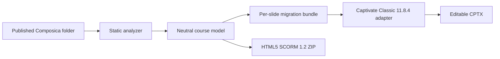

# Compos-a-toast

Compos-a-toast is a local-first desktop migration workbench for published legacy
Composica courses. It statically reconstructs course structure, slide objects,
interactions, and assets into a neutral model that can be exported as:

- an editable, per-slide migration bundle for reconstruction and Captivate assembly;
- an HTML5 single-SCO SCORM 1.2 package;
- a native editable-text `.cptx` draft through a version-pinned Adobe Captivate Classic adapter.

The application never launches a course's HTA, ActiveX controls, JavaScript, or
Flash files during extraction.

The desktop client is Electron end to end: a native Electron main process and secure
preload bridge with a framework-free HTML, CSS, and TypeScript renderer. On supported
Windows 11 versions it uses native caption controls and the Mica system backdrop;
Windows 10 and accessibility modes receive an opaque, system-theme-aware fallback.

> **Project status:** early MVP. Treat generated content as a migration draft and
> perform visual, interaction, accessibility, and LMS acceptance testing before
> production use. The initial Captivate adapter creates native slides and editable
> title text only; assets, interactions, detailed layout, and unsupported text remain
> explicit reconstruction work in the accompanying migration bundle. Native CPTX
> export is currently a developer-local beta, not a generally enabled public feature.

## How it works



The neutral model is the important boundary. Composica parsing happens once;
each output adapter consumes the same structure instead of reverse-engineering
the source again.

## Current capabilities

- Locates a published `Content/Projects/Res/project.xml` from several starting folders.
- Recovers the nested page, chapter, section, and test outline.
- Reads legacy page fragments and extracts positioned objects, text, styles, geometry,
  referenced media, interaction options, answer keys, and feedback where recoverable.
- Inventories course assets and flags Flash without executing it.
- Writes a portable folder per logical slide, including source evidence and Captivate
  reconstruction instructions. Inherited master/theme evidence and the assets they
  reference are carried into the slide folder as well.
- Builds an HTML5 SCORM 1.2 ZIP with an `imsmanifest.xml` at its root, a standalone
  fallback, basic native interactions, navigation, scoring, bookmarking, and resume state.
- Uses a locally qualified Adobe Captivate Classic `11.8.4.21` instance to create,
  save, close, reopen, and verify an editable-text CPTX draft without modifying the
  starter project. A supporting migration bundle is always retained for content that
  is not yet mapped to native Captivate objects.
- Provides a Windows-oriented desktop interface that follows light, dark, high-contrast,
  and reduced-transparency preferences without a browser UI framework.

Recovery is evidence-based, not magical. Dynamic runtime behavior, proprietary game
logic, server dependencies, and some deeply scripted interactions may need manual
rebuilding. Every export should retain diagnostics for that reason.

## Development in WebStorm

Requirements:

- Windows 10 or 11
- Node.js 22.12 or newer (this project is currently developed with Node.js 24)
- WebStorm 2025 or newer recommended

Open this repository as a WebStorm project. WebStorm should detect `package.json` and
offer to install dependencies. If PowerShell blocks `npm.ps1`, use the Windows command
shim explicitly in WebStorm's terminal:

```powershell
npm.cmd ci
npm.cmd run dev
```

Useful scripts:

```powershell
npm.cmd run dev                 # Electron + Vite development mode
npm.cmd start                   # Build and launch with the development Electron runtime
npm.cmd test                    # Unit tests
npm.cmd run test:e2e            # Build and run the Playwright Electron workflow test
npm.cmd run test:local-courses  # Read-only checks against ignored local samples
npm.cmd run test:captivate-live # Explicit live Classic 11.8.4 authoring/close/reopen test
npm.cmd run typecheck           # Main/preload/core and renderer TypeScript checks
npm.cmd run build               # Production Electron build
npm.cmd run package             # Signed unpacked app; signing credentials required
npm.cmd run package:unsigned    # Unsigned unpacked output for isolated inspection
npm.cmd run package:win         # Signed Windows installer; signing credentials required
npm.cmd run package:win:unsigned # Unsigned installer for isolated build inspection only
```

For a saved WebStorm run configuration, choose **npm**, select this `package.json`,
and use the `dev`, `test`, or `build` script. No JetBrains-specific project files are
required or committed.

## Using the MVP

1. Start the app with `npm.cmd run dev`.
2. Choose a published course folder. This may be the folder containing `run.hta`, the
   `Content` folder, `Projects`, `Res`, or the `project.xml` file itself.
3. Review the recovered slide, question, interaction, asset, and Flash counts.
4. Choose a destination and one or more working outputs:
   - **Editable migration bundle** for reconstruction and audit;
   - **HTML5 SCORM 1.2** for an LMS-ready package draft.
   - **Adobe Captivate (.cptx)** for an editable-text beta when the exact qualified
     Classic build and starter project are detected.
5. Review the export diagnostics and test the output.

The initial native Captivate profile is deliberately narrow. It requires signed Adobe
Captivate Classic build `11.8.4.21`, a SHA-256-pinned bundled driver, the exact one-slide
starter project that passed local qualification, and the live-qualified Windows desktop
profile: a DPI-unaware 96-DPI logical coordinate space on a 150% primary display with
the Captivate authoring window at `0,0,1280,696`. By default the app checks
`Documents\My Adobe Captivate Projects\untitled1.cptx`; developers may point to the
same qualified seed with `COMPOS_A_TOAST_CAPTIVATE_SEED_CPTX`. A changed or unqualified
starter remains disabled instead of risking a fabricated or corrupt CPTX. Captivate
opens during export; leave it untouched until the adapter closes it normally. The app
streams Captivate's current automation step while it runs. If it shows **Action needed
in Adobe Captivate**, choose **Continue Trial** in the verified Adobe trial window (or
**Continue Offline** if that is the label Adobe shows). Do not choose **Try Again** or
close Captivate; leave all other controls untouched so automation can resume safely.
The optional live integration test exercises the same complete sequence against a
disposable four-slide project and requires author, save, clean close, reopen, XML
marker verification, second clean close, output promotion, and an unchanged seed.

The repository does not redistribute the locally qualified `.cptx` seed. Therefore a
fresh public checkout or installation keeps native CPTX export disabled until a future
in-app seed-qualification workflow is implemented. The migration-bundle and SCORM 1.2
outputs do not depend on Captivate and remain available normally.

## Windows Smart App Control and signing

Windows Smart App Control or an organization-managed App Control policy can block the
unpacked application because electron-builder must modify Electron's executable and the
result has no trusted publisher signature. `Unblock-File` does not fix an unsigned
binary, and disabling Windows security is not the recommended development workflow.

For local WebStorm development, use either:

```powershell
npm.cmd run dev
# or, to exercise a production build locally:
npm.cmd start
```

The `package` and `package:win` commands deliberately fail instead of publishing an
unsigned Windows application. A distributable build requires an RSA code-signing
certificate from a trusted provider (or an organization certificate explicitly trusted
by its App Control policy), supplied through electron-builder's `WIN_CSC_LINK` and
`WIN_CSC_KEY_PASSWORD` environment variables. Certificates and passwords must not be
stored in this repository. See [Windows signing](docs/windows-signing.md).

## Repository data policy

The seven legacy courses used during development are intentionally ignored by Git:

```text
Activities/  AstroHops/  DeepSpace/  GameShow/
Introduction/  MasterPlumber/  OfficeErgo/
```

They remain local read-only integration fixtures and must not be committed to the
public repository. Tests committed here use newly written synthetic course fragments.
Generated exports, `.cptx` files, ZIPs, and dependency/build folders are also ignored.

## Security model

Published legacy courses are untrusted input. Compos-a-toast:

- reads source files as data;
- does not open `run.hta` or invoke the legacy runtime;
- does not evaluate recovered scripts or inline event handlers;
- never launches SWF/Flash content during ordinary extraction;
- uses Electron context isolation, a sandboxed renderer, and a narrow preload API;
- copies only resolved files within the selected course tree.

Do not launch legacy HTAs or old standalone Flash Player executables to validate a
course. Runtime-reference capture, if added later, should use a separately sandboxed
modern emulator and remain optional.

## Roadmap

- Expand native HTML5 renderers for drag-and-drop, hotspots, question banks, games,
  audio/video timing, and complex feedback branches.
- Add visual reference capture and pixel-difference QA without running unsafe legacy code.
- Validate manifests and learner-state behavior against SCORM Cloud and target LMSs.
- Add qualification profiles for more Adobe Captivate Classic builds and starter layouts.
- Expand native Captivate creation from slides/title text to positioned text, media,
  controls, quiz configuration, accessibility data, and publish verification.
- Add accessible reconstruction alternatives for interactions that cannot map directly.

See [Architecture](docs/architecture.md) and
[Captivate adapter contract](docs/captivate-adapter.md) for implementation boundaries.

## Independence and trademarks

Compos-a-toast is an independent open-source project. It is not affiliated with,
sponsored by, certified by, or endorsed by Composica, Adobe, 1EdTech, ADL, or Rustici
Software. Product and organization names are used only to identify formats and software
with which this migration tool interoperates. See [third-party notices](THIRD_PARTY_NOTICES.md).

## License

[MIT](LICENSE). This license applies to Compos-a-toast source code, not to any input
course, recovered third-party asset, Adobe product, or Composica runtime file.
