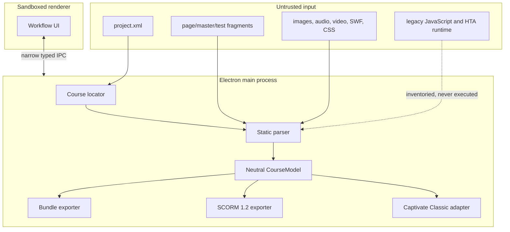

# Architecture

## Trust boundary

Input courses are untrusted, published output from a discontinued or inaccessible
authoring workflow. The analyzer is intentionally static. It reads text and binary
metadata, resolves references inside the selected tree, and records unsupported
features; it does not ask the legacy runtime what to do.

## Modules

### `src/core/composica`

Locates and parses a published Composica project into `CourseModel`. The parser owns
legacy format decisions: outline traversal, HTML fragment interpretation, interaction
detection, styles, geometry, assets, encodings, and diagnostics.

### `src/core/model.ts`

Defines the exporter-neutral representation. Export adapters should never need to
parse raw Composica XML or depend on its runtime.

### `src/core/bundle`

Writes an auditable, portable reconstruction package. A slide directory includes its
source evidence, structured objects, text, interactions, referenced assets, navigation
context, reconstruction notes, and proposed Captivate object names.

### `src/core/scorm`

Writes a single-SCO HTML5 runtime and packages it with a SCORM 1.2 manifest. SCORM API
integration is isolated inside the generated player so the same course can run in a
browser without an LMS during testing.

### `src/core/captivate`

Detects the exact Captivate Classic product/build and verifies its Adobe signature. The
open-smoke layer makes a hash-verified disposable CPTX copy and launches only that copy
through the verified executable. The first authoring driver is SHA-256-pinned to Classic
`11.8.4.21`, a qualified one-slide seed, and the live-qualified 150% primary-display
profile. It creates native slides and editable title
text through asserted Windows UI state, saves to a new file, closes, reopens, and checks
the exported XML before returning an attestation. Captivate's transient native menus and
dialogs are revalidated by stable geometry, labels, row positions, classes, and control
IDs; dynamic leaf command IDs are not trusted. Physical cursor points are hit-tested
against the expected exact window before input. The TypeScript adapter independently
checks the resulting ZIP structure, size, and SHA-256, then uses an atomic no-replace hard
link to publish the final output. No code fabricates or patches undocumented `.cptx`
internals.

### `src/main`, `src/preload`, and `src/renderer`

The main process performs filesystem work. The sandboxed renderer displays summaries
and submits typed requests through the preload bridge. Course paths and content are not
exposed through Node.js APIs in the renderer. The renderer is framework-free HTML, CSS,
and TypeScript; course-controlled values are assigned through DOM `textContent` rather
than HTML interpolation. The main process selects native Windows window controls and
Mica only on OS builds that support them, with system-theme and accessibility fallbacks.

## Export invariants

Every exporter should:

1. Resolve its destination to an explicit directory.
2. Sanitize filenames and prevent `..` traversal.
3. Write new output without modifying the source course.
4. Preserve diagnostics instead of silently discarding unsupported behavior.
5. Avoid emitting executable source scripts from the legacy package.
6. Keep text, images, and interaction data separate whenever editability is possible.

## Definition of done for a converted course

A generated file existing is not sufficient. Production acceptance should include:

- visual comparison for each slide and meaningful interaction state;
- keyboard and screen-reader review;
- answer, feedback, score, attempt, navigation, and completion checks;
- save/resume testing after closing and reopening the LMS session;
- manifest/file-reference validation, including case sensitivity;
- target-LMS testing and, for Captivate, save/reopen/publish verification.
